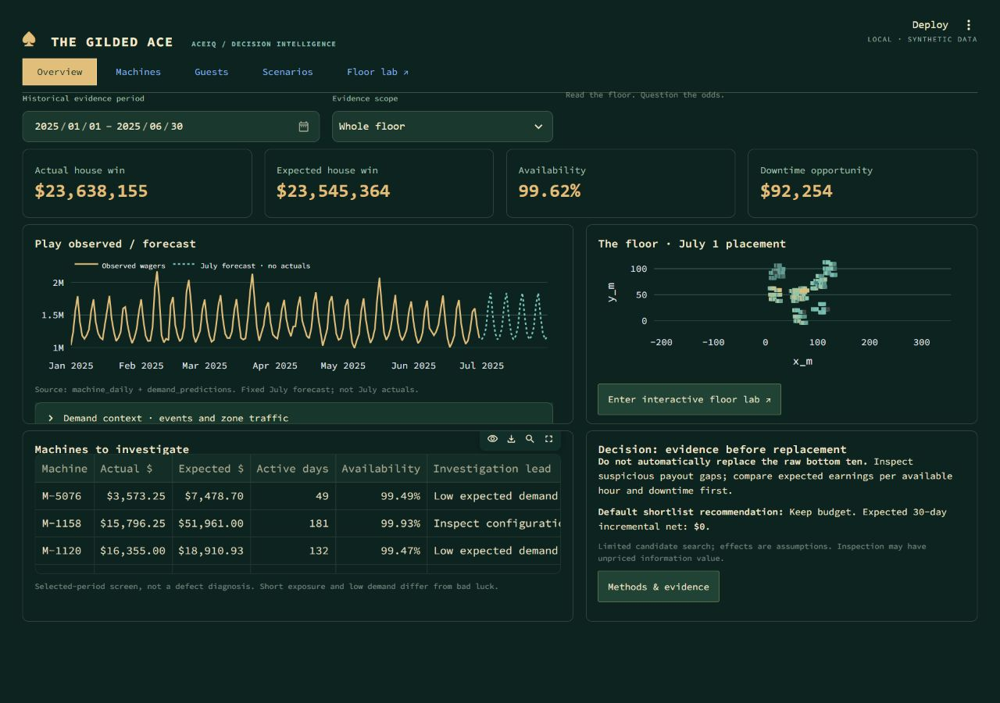
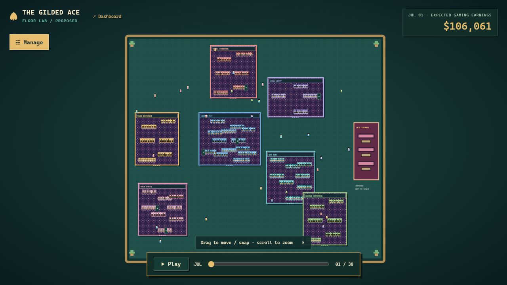

# The Gilded Ace · ACEIQ

A local Python/Streamlit decision dashboard and a separate interactive SVG casino floor. All casino and guest data is synthetic. January–June 2025 is observed history; July 1–30 is a modeled decision horizon, not the current date.

The current version brings the compact dashboard and interactive floor lab into this repository. Earlier versions remain in Git history. The original data exports, analysis notebooks and shared financial models are unchanged. The app runs locally; publishing this code to GitHub does not create a public dashboard.

## Run it

On Windows, double-click **START_DASHBOARD.cmd**. On first use it creates a Python 3.12 virtual environment and installs the required packages. Keep the terminal open; Ctrl+C stops both services. After pulling updates, rerun the dependency-install command below if requirements changed.

- Dashboard: <http://127.0.0.1:8501/>
- Floor lab: <http://127.0.0.1:8502/floor-lab>

These are local addresses, not public judge links. Stop any previous app occupying these ports before starting. The launcher does not terminate unrelated processes.

To set up manually in VS Code, open the repository folder and run these commands in its terminal:

```powershell
py -3.12 -m venv .venv
.venv\Scripts\python -m pip install -r requirements.txt
.venv\Scripts\python run_local.py
```

For F5, select that Python environment in VS Code and choose **Run dashboard + floor lab**. The terminal prints both addresses. No Databricks login, Gemini key or cloud account is required. Node is needed only for the geometry tests, not to run the app.

On macOS/Linux, use `python3.12 -m venv .venv`, `.venv/bin/python -m pip install -r requirements.txt`, then `.venv/bin/python run_local.py`. Select your local virtual environment in VS Code.

## Five destinations

| Destination | Purpose |
|---|---|
| Overview | Actual/expected house win, availability, downtime opportunity, observed/forecast wagers, placement preview and investigation leads. |
| Machines | Search machines; filter by bank; inspect cumulative earnings, selected-period payout variance, monthly/daily availability, theme peers and placement history. |
| Guests | Complete-month grouped wagers, payouts, player net, expected player loss and comps; region filter; explicitly fixed full-cohort concentration. |
| Scenarios | Cash ceiling, retained-play sensitivity, original nine targets re-evaluated by the shared engine, ranked feasible portfolios, keep-budget and forecast evidence. |
| Floor lab | Opens a standalone local page with placements, a minimal HUD, decorative guests, drag/drop, pan/zoom, July playback, previews, suggestions and plan undo. |

Metrics use bounded panels; deeper methods and tables are optional. Smaller screens can scroll dashboard panels/page. The floor itself has no page scroll. Use Manage → View controls to focus a zone, zoom, Fit, pause ambient guests, or compare Baseline and Proposed layouts. Baseline is read-only.

## Floor actions

- Move an eligible original machine to a legal vacancy, or drag it onto another unchanged original machine to review a swap. Moves activate July 3. A swap uses two move units, $3,600 cash, shared uncertainty, and atomic activation/undo; it preserves both identities.
- Inspect, lease-replace or maintain an eligible manufacturer. Manufacturer maintenance covers all eligible original machines in that scope.
- Add/remove are explicitly labeled **what-if extensions**. Enter cash cost, activation day and incremental/retained-play share. Additions use an existing performance proxy and get a NEW- ID. Undo and recreate an addition to change it.
- Preview never changes the plan. Confirmation validates again. A removal can free a slot for an arrival at or after its activation. Undo dependent arrivals before undoing that removal. Chained moves and overlapping targets are rejected.
- The $100,000 **cash** limit, at most three action types (including what-if types), catalogue quantities, target conflicts and destination reservations are validated centrally.

Plans live only in browser memory; refresh resets them. Export plan JSON and daily CSV manually from the Plan drawer. No plans or source data are written to the server. Only the dismissible hint uses tab-session storage.

## Models and interpretation

The floor and Scenarios reuse `dashboard/decisions.py` and the saved July machine forecasts. They use the existing shared engine's **1,000 seeded draws**, not an LLM. Day-30 catalogue-action net samples reconcile to that engine. The original `analysis_results.json` simulation and `scenario_net.npz` are retained as historical version-1 evidence; those samples are not interchangeable with the shared engine's later draws.

Upfront catalogue costs are charged on July 1; recurring lease cash starts at activation. Benefits and planned downtime begin at activation. Maintenance benefits are spread across eligible days; other catalogue benefits follow the target's daily forecast share. This timing is a planning allocation, not a learned intraday response. Cash is separate from downtime opportunity.

Expected gaming earnings are before action cash and baseline operating costs. Incremental net is the difference from the unchanged forecast after action cash and planned downtime. Neither is total business profit. July outcomes are unavailable.

Suggested changes search individually feasible original-machine moves, lease replacements and manufacturer maintenance, ranked against the **current** plan. Moves use the first legal vacancy: there is no estimated destination-specific causal effect. Swaps, add/remove and combinations are outside suggestion search. Positive suggestions may appear even though the original nine-target shortlist favors keeping budget; these are different search scopes.

Probabilities and 10th–90th percentiles describe assumed effects, not measured treatment success. Addition performance is triangular 0.5/1/1.5 times a supplied proxy with entered incremental-play share. Removal retains only the entered share of its forecast play elsewhere. No resale, lease savings or operating savings are invented. Decorative guests have no connection to earnings. Illustrated rooms are not a surveyed building.

## Screenshots





[Swap preview](docs/swap-preview.png) · [Suggested changes](docs/suggestions.png)

## Files and evidence

- `app.py`, `assets/dashboard.css`: compact Streamlit dashboard.
- `dashboard/floor_simulation.py`: validation, daily cash/effects, layouts, preview/confirm/undo, suggestions.
- `dashboard/floor_server.py`: localhost-only HTTP API and static asset server.
- `assets/floor-world.html`, `.css`, `.js`: standalone accessible controls and SVG floor.
- `assets/floor-motion.js`: pure zoom, drop-target, route and obstacle helpers.
- `dashboard/analytics.py`, `forecast.py`, `decisions.py`: existing shared model definitions, unchanged.
- `data/`: original exports, unchanged. `analysis/` and `notebooks/`: historical reproducible analysis, unchanged.
- [Claims & Evidence](docs/CLAIMS_AND_EVIDENCE.md), [AI disclosure](docs/AI_DISCLOSURE.md), [local rebuild notes](docs/LOCAL_REBUILD.md).
- `docs/archive/`: frozen baseline documentation. Other inherited long-form guides describe earlier versions; use this README and LOCAL_REBUILD for current behavior.

The included runtime data files are listed below. Keep them in `data/` when cloning or copying the project.

```text
analysis_results.json
machines.parquet
machine_daily.parquet
guest_groups.parquet
property_daily.parquet
scenario_net.npz
daily_variance.parquet
demand_predictions.parquet
forecast_metadata.json
floor_locations.parquet
floor_walkways.parquet
placements.parquet
``` It does not download data or call external APIs. Databricks notebooks document the original work; runtime uses local exports. Gemini chat is not implemented.

## Checks

```powershell
python tests/test_results.py
python tests/test_upgrade.py
python tests/test_floor_simulation.py
python tests/test_floor_api.py
python tests/test_compact_app.py
node tests/test_floor_motion.cjs
```

Use your selected Python environment. `tests/test_app.py` is inherited and targets an earlier UI; the compact-app test replaces it for this rebuild. See LOCAL_REBUILD for actual checks performed and limits. Data attribution/license remains in `LICENSE-data.txt`.
