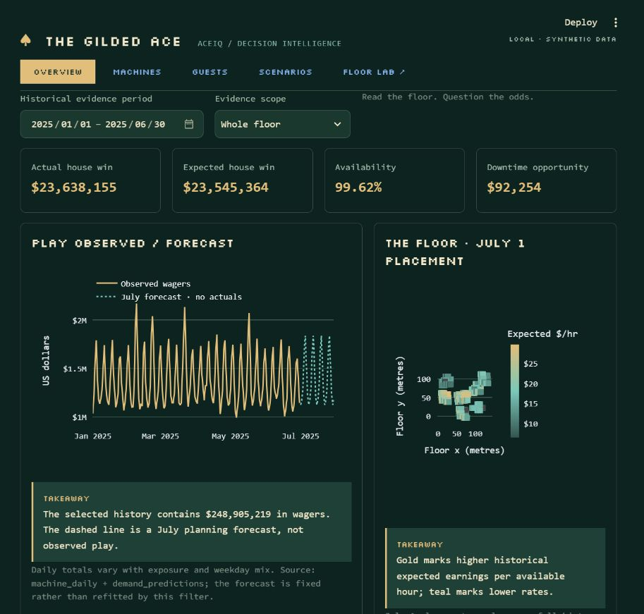
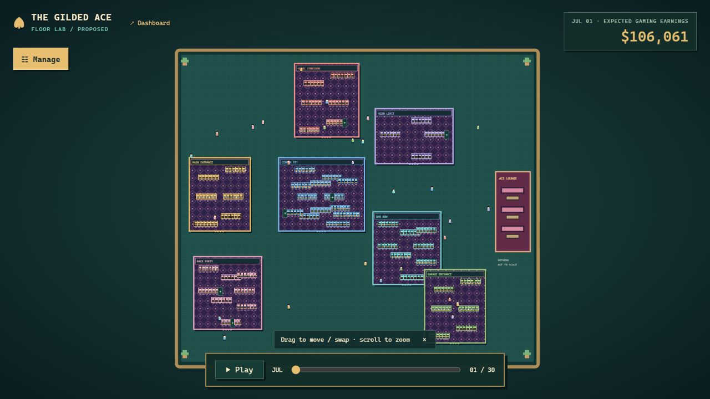
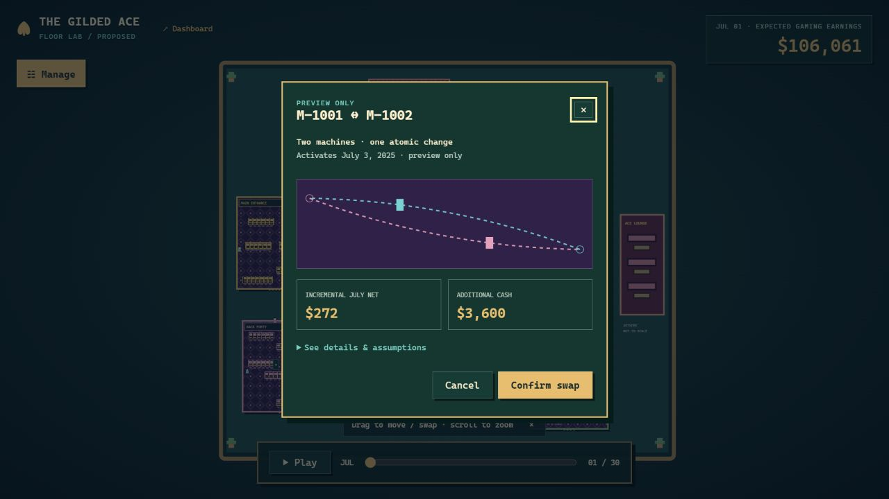
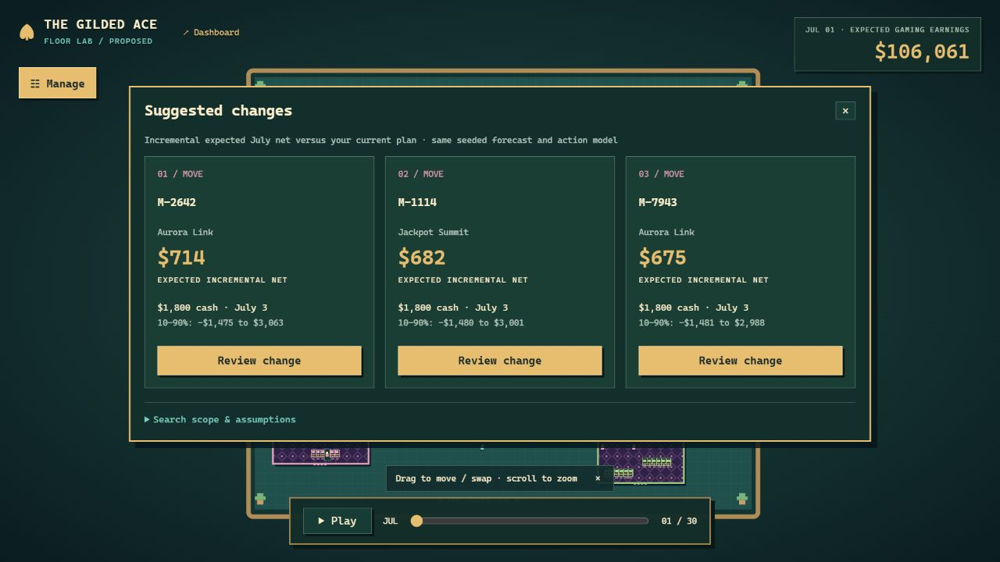

# Local rebuild: implementation and verification

November 8, 2026. Implemented from the user-approved attached rebuild specification. The rebuild was developed separately from `08dab59de75264b5b52b8327380c7a406c597a2d`, then integrated on top of repository commit `25e345f` after the user authorized a GitHub push. Earlier versions are preserved in Git history. This document records implementation and local verification; public deployment remains separate.

## Start and architecture

Double-click `START_DASHBOARD.cmd`, or run `python run_local.py` with the project environment selected. Keep the launcher running; Ctrl+C stops both services. See the root README for installation and VS Code instructions.

- Dashboard: http://127.0.0.1:8501/
- Floor lab: http://127.0.0.1:8502/floor-lab

These addresses work only on the computer running the services. They are not public judge links.

Streamlit renders Overview, Machines, Guests and Scenarios. The fifth destination opens the separate HTML/CSS/JavaScript SVG floor. A Python localhost HTTP server exposes bootstrap, evaluate, preview, confirm, undo and suggestions. Both interfaces reuse local exports and the existing shared decision engine. There is no live Databricks or Gemini connection.

The floor uses the supplied July 1 machine placements, slot coordinates and configurations. The initial layout has 308 machines and six vacancies. Decorative room borders, carpet, furnishings and walking guests do not represent measured customer behavior or a surveyed building. Guests use obstacle-avoiding paths independently of financial playback.

## Financial boundaries

Existing analytics, forecasting and decision-engine definitions are unchanged. The floor adds validation and a daily allocation of the existing July effects. Catalogue costs are charged upfront on July 1, except recurring lease costs starting on activation. Planned downtime is charged on activation. Non-maintenance benefits follow each target's daily forecast share; maintenance benefits are distributed across eligible days. This allocation is a planning assumption, not a learned day-specific intervention effect.

The shared engine uses 1,000 seeded draws. Catalogue day-30 net samples reconcile to its outputs. A swap combines two move actions with shared draws, $3,600 cash, two move units and atomic activation/undo. Machine identity and supplied configuration are preserved. The older saved simulation in `analysis_results.json` and `scenario_net.npz` remains historical evidence and is identified separately in the dashboard.

Add/remove actions are explicitly hypothetical. An addition uses a supplied machine forecast proxy, triangular 0.5/1/1.5 performance uncertainty and entered incremental-play share. A removal loses forecast play after activation except for the entered retained share. Entered cash is charged upfront; no resale proceeds or operating savings are invented.

Expected gaming earnings exclude action cash and baseline operating costs. Incremental net subtracts action cash and planned downtime from modeled incremental contribution. Neither is total business profit. Percentiles and probabilities are conditional on these assumptions; July outcomes are unavailable.

Suggestions rank individually feasible positive marginal-net moves, lease replacements and manufacturer maintenance against the current plan. They do not optimize combinations or a global layout. Moves use the first legal vacancy because destination-specific causal effects are unknown. The broader floor search can produce positive suggestions even when the original nine-target dashboard shortlist recommends keeping budget.

## Automated checks performed

All checks below passed in the local environment. Relevant checks were repeated after changes to their corresponding code; no claim is made that every inherited historical test targets this UI.

Before the GitHub update, all six listed test scripts, the JavaScript syntax check and `START_DASHBOARD.cmd --check` were run again successfully from the integrated repository. No data, analysis, notebook or shared-model file was changed during integration. The screenshots and browser checks below were captured from the same rebuild before repository integration.

| Check | What it verifies |
|---|---|
| `tests/test_results.py` | Original financial reconciliation, portfolio feasibility and saved simulation consistency; three tests. |
| `tests/test_upgrade.py` | Selected-period payout variance, July placement, forecast leakage boundaries, shared scenario math and budget feasibility. |
| `tests/test_floor_simulation.py` | Nine tests covering daily cash/effects, engine reconciliation, swap identity/configuration/roster preservation, atomic undo, pure previews, confirmation hashes, malformed inputs, occupancy/reservations, overlapping targets, budget/type/quantity limits, removal/addition dependencies and deterministic marginal suggestions. |
| `tests/test_floor_api.py` | Two tests covering live local preview/confirmation behavior, rejected origins/hosts/content types, malformed plans, unknown fields and routes. |
| `tests/test_floor_motion.cjs` | Preview endpoints, distinct paired swap paths, pointer-anchored zoom and clamping, drop targets and obstacle-avoiding routes. |
| `tests/test_compact_app.py` | Four analytical destinations render; regional filtering, zero-budget keep option, incomplete date selection and complete June selection behave correctly. |
| `node --check assets/floor-world.js` | JavaScript syntax. |

The inherited `tests/test_app.py` expects the previous UI. `tests/test_compact_app.py` is its replacement for this copy. No extra ML package is required. Node is needed only for JavaScript checks.

## Browser checks performed

Verified in the local in-app browser using actual UI interactions:

- Dashboard at 1280 x 900 and a 390 x 844 viewport: compact desktop panels, stacked mobile layout and no horizontal overflow. Floor checked at desktop and mobile sizes without page scrolling. These are viewport checks, not physical-device tests.
- Searchable themed controls, keyboard search/selection, manufacturer maintenance target retention and supplied configuration display.
- Move preview, cancellation, confirmation and July 3 activation. Preview leaves actual tiles unchanged. Undo restores the original position and cash.
- Dragged M-1001 onto M-1002: paired swap preview, confirmation, July 3 position exchange, unchanged 308-machine roster and single-entry undo.
- During held native pointer drags across machines and an earnings overlay, computed cursor remained `grabbing` and text selection stayed empty. Pointer release restored normal overlay cursor behavior. This was checked during the gesture, not only afterward.
- Baseline mode rejected editing; drag displayed machine details without a review or layout change.
- Suggested changes displayed three ranked cards; reviewing a suggestion reproduced its estimate and cancelling did not apply it. Small-screen cards stacked within the drawer.
- Pointer-anchored wheel zoom, background pan and Fit reset. Wheel input over the panel did not zoom the floor.
- Twenty-eight decorative guests changed positions; pausing ambient animation held their positions fixed. Financial day controls were checked independently.
- Restarted services after the final backend change and verified both final pages loaded. Test plans were cleared before handoff.

The code supports reduced-motion preferences with static preview endpoints and paused ambient guests. OS-level reduced-motion emulation was not available in these checks, so that behavior is not claimed as visually verified. Full 30-day autoplay, physical touch input, screen-reader behavior and browser Ctrl/Cmd-wheel zoom were not manually audited. Automated geometry and validation checks do not establish full accessibility or physical relocation feasibility.

## Source integrity and local boundaries

`source-integrity.json` records comparison with the requested baseline. Nineteen data, analysis, notebook and shared-model files have unchanged content. Binary exports are byte-identical. Git archive converted line endings in nine text files; their content is unchanged after newline normalization. The teammate checkout was clean before integration. The source-integrity manifest records the pre-integration comparison.

The HTTP API binds to localhost, validates hosts and POST origins, limits JSON request sizes and rejects unknown fields and invalid/non-finite values. It has no credential requirement or external API calls. Plans remain in browser memory and reset on refresh; use the Plan drawer's JSON/CSV exports to keep a copy. Only hint dismissal uses tab-session storage. There is no plan import or server-side persistence.

This local two-service architecture needs a separate hosting design before public deployment. GitHub receives the source update; no public floor hosting is configured by this handoff. If an existing hosting service watches the branch, it may rebuild automatically, but the two-service floor still requires its own hosting configuration.

## Final screenshots

Current evidence: [Claims & Evidence](CLAIMS_AND_EVIDENCE.md), its CSV counterpart, and [AI disclosure](AI_DISCLOSURE.md). Baseline versions are retained under `archive/`.

## Final reference and readability pass

The PDF reference comparison is recorded in `REFERENCE_COMPARISON.md`. The original pixel font, larger labels, explanatory summaries, three ranking modes, negative-value visibility, residual/event/traffic/downtime views, loyalty-change charts and optional Evidence Claw were verified locally. `test_reference_consistency.py` adds four independent reconciliation checks. `test_compact_app.py` now inspects rendered chart coordinates, three ranking pools, claw membership and date-reset behavior. The runtime floor and shared models are unchanged. `DEVPOST.md` contains a 363-word project description; this is a draft file, not a submission to Devpost.
